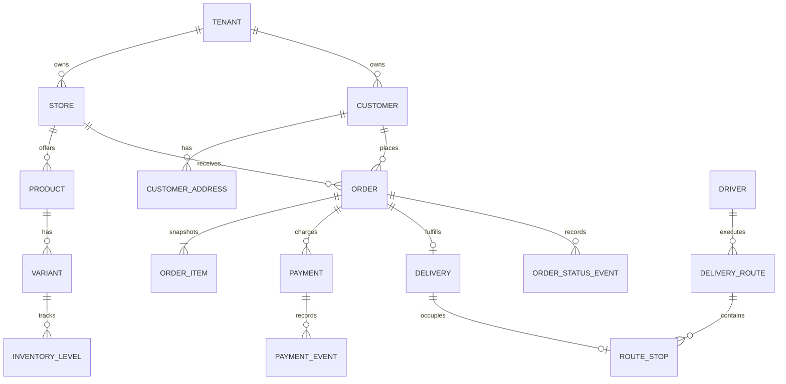

# Modelo canônico do SamJoE FoodApp

Status: v1 para implementação e simulação local.  
Premissa: não existe ambiente de produção nem dado real a migrar. `E:\samjoe` é referência funcional; o FoodApp nasce como fonte de verdade.

## Vocabulário

| Termo | Definição |
|---|---|
| Tenant | Empresa cliente isolada técnica e comercialmente. |
| Loja | Unidade operacional de um tenant, com catálogo, horários, origem de entrega e timezone próprios. |
| Cliente | Pessoa que realiza pedidos em um tenant. Não é compartilhada entre tenants. |
| Produto | Conceito comercial exibido no catálogo, como “Bolo de pote”. |
| SKU/variante | Unidade vendável de um produto, como sabor e tamanho, com preço e estoque próprios. |
| Adicional | Opção vendável associada a um grupo, como cobertura ou embalagem. |
| Pedido | Compromisso comercial contendo snapshots imutáveis de cliente, endereço, itens, preços e frete. |
| Pagamento | Tentativa ou cobrança financeira associada a um pedido. O estado financeiro é separado do estado do pedido. |
| Entrega | Execução logística de um pedido. Retirada não exige uma entrega. |
| Rota | Agrupamento ordenado de entregas executado por um motorista. |
| Evento | Fato imutável ocorrido no domínio, publicado por outbox. |

## Decisões invariantes

- IDs internos são UUID; números públicos são apenas identificadores de apresentação.
- Dinheiro é inteiro em centavos e inclui código ISO 4217, inicialmente `BRL`.
- Timestamps são UTC; `tenants.timezone` e `stores.timezone` guardam a zona de apresentação.
- Toda entidade comercial contém `tenant_id`; referências compostas impedem vínculo entre tenants.
- O tenant é resolvido pelo servidor a partir de host/sessão/chave, nunca aceito cegamente do corpo público.
- Itens do pedido guardam nome, SKU, atributos, quantidade e preço como snapshot.
- Endereço, cotação e regras de preço usadas no checkout também são snapshots.
- Provedores externos ficam atrás de portas internas e `external_identifiers`.
- Entrada repetível usa inbox/idempotência; saída externa nasce de outbox transacional.
- Segredos são referências para um cofre/configuração segura, nunca texto devolvido pela API.

## Relações principais



## Estados canônicos

### Pedido

```text
PAYMENT_PENDING -> NEW -> CONFIRMED -> IN_PREPARATION -> READY
READY -> OUT_FOR_DELIVERY -> COMPLETED
READY -> READY_FOR_PICKUP -> COMPLETED
qualquer estado não terminal -> CANCELLED
PAYMENT_PENDING -> PAYMENT_FAILED | CANCELLED
```

Transições incompatíveis são rejeitadas com `409 state_conflict`. Mudanças geram `order_status_events` e um evento de domínio.

### Pagamento

```text
CREATED -> PENDING -> AUTHORIZED -> PAID
CREATED | PENDING | AUTHORIZED -> FAILED | EXPIRED | CANCELLED
PAID -> PARTIALLY_REFUNDED -> REFUNDED
PAID | PARTIALLY_REFUNDED -> CHARGEBACK
```

### Estoque

Uma variante usa uma política explícita:

- `UNLIMITED`: não controla saldo;
- `TRACKED`: exige saldo e reserva transacional;
- `PREORDER`: aceita saldo negativo até limite configurado.

Reserva começa `ACTIVE` com expiração, torna-se `COMMITTED` ao confirmar a venda ou `RELEASED`/`EXPIRED`. O saldo disponível é `on_hand - active_reserved` para `TRACKED`.

### Entrega e rota

- Entrega: `PENDING`, `ASSIGNED`, `IN_TRANSIT`, `DELIVERED`, `FAILED`, `CANCELLED`.
- Rota: `DRAFT`, `AWAITING_ACCEPTANCE`, `ACCEPTED`, `IN_PROGRESS`, `COMPLETED`, `REJECTED`, `CANCELLED`.
- Motorista: `UNAVAILABLE`, `AVAILABLE`, `RESERVED`, `DELIVERING`, `RETURNING`.

## Mapa do protótipo para o canônico

| Referência em `E:\samjoe` | Estado canônico |
|---|---|
| `Aguardando pagamento` | `PAYMENT_PENDING` |
| `Novo` | `NEW` |
| `Confirmado` | `CONFIRMED` |
| `Em produção` | `IN_PREPARATION` |
| `Pronto` | `READY` |
| `Saiu para entrega` | `OUT_FOR_DELIVERY` |
| `Concluído` | `COMPLETED` |
| `Cancelado` | `CANCELLED` |

Valores desconhecidos nunca viram `NEW` silenciosamente; são rejeitados ou enviados para quarentena de importação.

## Eventos e integrações

O envelope versionado está em `contracts/schemas/event-envelope.v1.schema.json`. O `type` segue `foodapp.<aggregate>.<event>.v1`, por exemplo:

- `foodapp.order.created.v1`;
- `foodapp.order.status_changed.v1`;
- `foodapp.payment.status_changed.v1`;
- `foodapp.customer.upserted.v1`;
- `foodapp.delivery.completed.v1`.

FoodApp é a fonte de verdade. n8n, Evolution, Mercado Pago, Google e Sales Engine são consumidores ou provedores substituíveis.

## Cenário fictício padrão

O ambiente local usa o tenant `Doce Horizonte Demo`, loja `Centro`, produtos e clientes inventados. Telefones usam a faixa reservada nos fixtures do projeto e e-mails usam `example.test`. Nenhuma integração externa fica habilitada por padrão.

