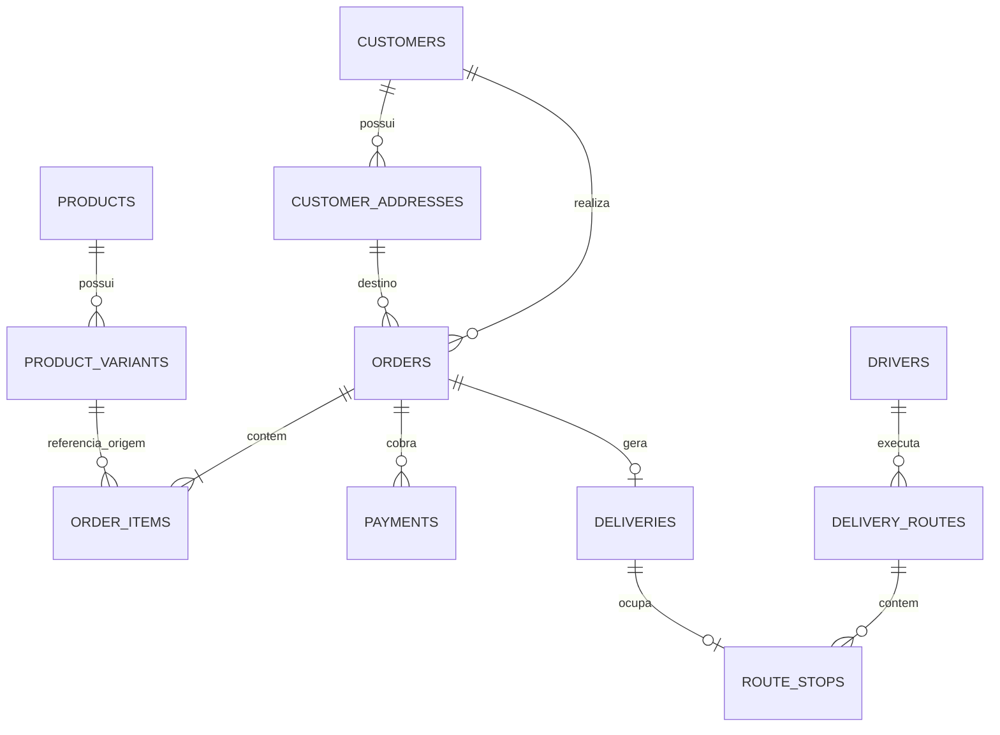

# Mapa do legado para o modelo canônico

Data da análise: 2026-10-10. Fontes: dois templates XLSX locais e `MVP_Operacao_Web_V3.gs`.

## Limite da evidência

Os arquivos XLSX são modelos estruturais. As abas principais de clientes, endereços, produtos, rotas e itens não contêm registros reais. A aba `Pedidos` contém 199 linhas de fórmulas-modelo, não 199 pedidos. Este mapa pode orientar o schema, mas tipos nulos, cardinalidade real, qualidade, duplicidade e estados efetivamente usados ainda dependem de uma exportação sanitizada da produção.

O Apps Script V3 é mais novo que o XLSX operacional: ele acrescenta campos financeiros em `Pedidos` e usa `cpf` e `email` em `Clientes`, embora essas duas colunas não existam no template local da base de clientes.

## Relações comprovadas

O item do pedido deve guardar um snapshot imutável de nome, sabor, tamanho e preço. A referência ao catálogo serve para rastreabilidade, não para recalcular o passado.

## Tabelas canônicas mínimas

Toda entidade comercial recebe `tenant_id`. IDs internos são UUID. IDs do legado e de provedores ficam em `external_identifiers` ou em colunas externas com restrição única por tenant/provedor.

| Tabela | Finalidade | Origem principal |
|---|---|---|
| `tenants`, `stores` | isolamento e configuração da operação | configuração hoje implícita na planilha |
| `customers` | cadastro atual do cliente | `Clientes` |
| `customer_addresses` | endereços reutilizáveis | `Enderecos` |
| `consent_events` | evidência de aceite/revogação | `aceite_privacidade`, `data_aceite` |
| `products`, `product_variants` | catálogo e SKU vendável | `Produtos` |
| `inventory_levels`, `inventory_movements`, `inventory_reservations` | saldo, baixa e reserva concorrente | `estoque_disponivel`; capacidade ausente no legado |
| `orders` | cabeçalho e snapshots do pedido | `Pedidos` |
| `order_items` | itens e preço congelado | `ItensPedido` |
| `order_status_events` | histórico imutável de transições | estado atual + logs do Apps Script |
| `delivery_quotes` | distância, duração, área, preço e custo calculados | fórmulas `Pedidos!L:P` e Google Routes |
| `deliveries` | execução da entrega de um pedido | `Pedidos.Entrega` e `ItensRota` |
| `drivers` | motoboys | `Motoboys` |
| `delivery_routes`, `route_stops` | agrupamento e ordem de entregas | `Rotas`, `ItensRota` |
| `payments`, `payment_events`, `refunds` | cobrança, eventos do provedor e estornos | colunas financeiras adicionadas pelo V3 |
| `external_identifiers` | IDs de Sheets, WhatsApp, Mercado Pago e outros provedores | IDs técnicos do legado |
| `idempotency_keys`, `integration_inbox`, `integration_outbox`, `webhook_attempts` | deduplicação e efeitos externos confiáveis | `message_id`, webhooks e comportamento do Apps Script |
| `audit_events` | trilha operacional | `LogsMVP` |

## Clientes

| Campo legado | Destino proposto | Tipo/decisão |
|---|---|---|
| `cliente_id` | `external_identifiers.external_id` | preservar `CLI-*`; UUID interno separado |
| `telefone_e164` | `customers.phone_e164` | texto normalizado; `UNIQUE (tenant_id, phone_e164)` quando presente |
| `nome` | `customers.name` | texto |
| `nome_whatsapp` | `customers.whatsapp_name` | texto anulável |
| `status_cliente` | `customers.status` | enum canônico |
| `origem_cadastro` | `customers.acquisition_source` | enum aberto/versionado; não usar como autorização de marketing |
| `aceite_privacidade`, `data_aceite` | `consent_events` | evento com finalidade, origem e timestamp; `PENDENTE` não é consentimento |
| `cpf` | `customers.tax_id_*` | existe no V3, não no XLSX; criptografar e manter hash para busca quando necessário |
| `email` | `customers.email` | existe no V3, não no XLSX; normalizar em minúsculas |
| `criado_em`, `atualizado_em` | timestamps da entidade | converter para UTC; timezone do tenant separado |
| `ultimo_pedido_em`, `qtd_pedidos`, `valor_total_pedidos` | projeção/consulta agregada | não são fonte primária; recalcular de `orders` |
| `observacoes_internas` | `customers.internal_notes` | texto com controle de acesso e auditoria |

## Endereços

| Campo legado | Destino proposto | Tipo/decisão |
|---|---|---|
| `endereco_id` | identificador externo | preservar `END-*`; UUID interno separado |
| `cliente_id` | `customer_addresses.customer_id` | FK obrigatória |
| `tipo_endereco` | `label` | `HOME`, `WORK`, `OTHER` |
| `principal`, `ativo` | `is_primary`, `is_active` | booleanos; no máximo um principal ativo por cliente |
| `endereco_informado` | `raw_address` | texto original para auditoria |
| `logradouro` a `cep` | campos postais | `postal_code` como texto; não converter CEP em número |
| `endereco_formatado` | `formatted_address` | texto retornado/normalizado |
| `latitude`, `longitude` | coordenadas | decimal; validar limites geográficos |
| `place_id` | identificador do provedor | não usar como PK interna |
| `status_validacao`, `fonte_validacao` | estado e provedor da validação | considerar histórico em `address_validation_events` |
| `distancia_origem_km`, `tempo_origem_min`, `area_atendimento` | último resultado de cotação | dado derivado e perecível; o pedido deve guardar seu próprio snapshot em `delivery_quotes` |
| `criado_em`, `atualizado_em` | timestamps | UTC |
| `observacoes` | instruções do endereço | separar de `delivery_instructions` do pedido quando variar por compra |

## Pedidos e entregas

| Campo legado | Destino proposto | Tipo/decisão |
|---|---|---|
| `ID` | `orders.public_number` | número legível; não é a PK |
| `pedido_uid` | identificador externo do pedido | preservar `PED-*`; UUID interno separado |
| `Data`, `criado_em`, `atualizado_em` | `placed_at`, `created_at`, `updated_at` | definir precedência durante importação |
| `cliente_id`, `endereco_id` | FKs de `orders` | manter também snapshots históricos |
| `Cliente`, `Telefone` | snapshot do cliente | não depender do cadastro mutável para exibir pedido antigo |
| `Endereço completo`, `Complemento / referência` | snapshot de entrega | JSON/colunas imutáveis no pedido |
| `Valor do pedido` | `orders.subtotal_cents` | confirmar semântica em produção; dinheiro em centavos |
| `Pagamento` | método legado | normalizar em `payments.method`; não confundir com status financeiro |
| `Situação do pedido` | `orders.status` | estado atual; toda mudança gera `order_status_events` |
| `Distância (km)`, `Tempo (min)`, `Área de atendimento` | `delivery_quotes` | snapshot da cotação usada |
| `Frete sugerido` | `orders.delivery_fee_cents` | valor cobrado congelado |
| `Custo entrega avulsa` | `delivery_quotes.estimated_cost_cents` | estimativa interna |
| `Resultado do frete` | margem derivada | `delivery_fee - estimated_cost`; pode ser materializada para auditoria |
| `Margem do frete` | percentual derivado | não é fonte primária |
| `Ordem da rota` | `route_stops.sequence` | pertence à parada, não ao pedido |
| `Abrir no Maps` | projeção | URL regenerável; não é dado mestre |
| `Entrega` | `deliveries.status` | estado de execução separado de `orders.status` |
| `Observações` | `orders.notes` | texto |
| `rota_id`, `motoboy_id` | relações de entrega | FK; o histórico deve permanecer em eventos |
| `origem_cadastro` | `orders.source` | canal de criação |
| `itens_resumo` | projeção | regenerar de `order_items` |
| `message_id` | `idempotency_keys`/identificador externo | único por tenant + canal quando presente |
| `conversation_id` | identidade externa de conversa | não acoplar o núcleo ao WhatsApp |

## Pagamentos adicionados pelo Apps Script V3

| Campo V3 | Destino proposto | Decisão |
|---|---|---|
| `status_pagamento` | `payments.status` | mapear para enum canônico; não reutilizar status do pedido |
| `provedor_pagamento` | `payments.provider` | adaptador interno |
| `order_pagamento_id` | identificador externo do pagamento/order | único por tenant + provedor |
| `checkout_url` | sessão/link de checkout | dado transitório e potencialmente expirável |
| `valor_pagamento` | `payments.amount_cents` | inteiro em centavos |
| `atualizado_pagamento_em`, `pago_em` | timestamps financeiros | UTC |
| `status_order_mp`, `detalhe_status_order_mp` | `payment_events.provider_*` | preservar payload/estado bruto para auditoria |
| `ultimo_evento_pagamento_id` | inbox/deduplicação | impedir reprocessamento de webhook |

## Catálogo e estoque

| Campo legado | Destino proposto | Tipo/decisão |
|---|---|---|
| `produto_id` | identificador externo/SKU | preservar para imagens e migração |
| `nome` | `products.name` | produto conceitual |
| `sabor`, `tamanho` | atributos de `product_variants` | a combinação vendável recebe ID próprio |
| `preco` | `product_variants.price_cents` | centavos inteiros |
| `ativo` | `product_variants.is_active` | booleano |
| `estoque_disponivel` | `inventory_levels.on_hand` | nulo hoje significa “sem limite conhecido”; modelar política explícita |
| `atualizado_em`, `observacoes` | metadados | UTC e texto |

O legado apenas lê o saldo. O modelo novo precisa de movimentos e reservas transacionais para impedir venda acima do estoque.

## Rotas e motoboys

`Motoboys` mapeia para `drivers`; `Rotas` para `delivery_routes`; `ItensRota` para `route_stops`. Os campos repetidos de nome, telefone, cliente e endereço em rotas/paradas são snapshots de apresentação. As relações devem usar IDs internos.

Custos, distância, duração, frete total e ordem das paradas devem permanecer congelados na rota executada. `link_maps` é projeção regenerável. Aceite, recusa, início e conclusão devem gerar eventos com ator, origem e timestamp.

## Estados observados nos templates

| Domínio | Valores observados |
|---|---|
| Cliente | `ATIVO`, `INATIVO`, `BLOQUEADO` |
| Origem de cliente | `WHATSAPP`, `PAINEL`, `IMPORTACAO`, `APP`; o código também usa `WHATSAPP_FORM` |
| Aceite | `PENDENTE`, `SIM`, `NAO` |
| Tipo de endereço | `CASA`, `TRABALHO`, `OUTRO` |
| Validação de endereço | `PENDENTE`, `VALIDO`, `REVISAR`, `INVALIDO` |
| Fonte de validação | `ROUTES`, `GEOCODING`, `ADDRESS_VALIDATION`, `MANUAL` |
| Área | `DENTRO_5KM`, `EXCECAO_5_10KM`, `FORA_10KM`, `NAO_CALCULADO`; a planilha operacional usa rótulos equivalentes em português |
| Pedido | `Aguardando pagamento`, `Novo`, `Confirmado`, `Em produção`, `Pronto`, `Saiu para entrega`, `Concluído`, `Cancelado` |
| Entrega | `PENDENTE`, `EM_ROTA`, `ENTREGUE`, `NAO_ENTREGUE` |
| Motoboy | `INDISPONIVEL`, `DISPONIVEL`, `RESERVADO`, `EM_ENTREGA`, `RETORNANDO` |
| Rota | `CRIADA`, `AGUARDANDO_ACEITE`, `ACEITA`, `EM_ANDAMENTO`, `CONCLUIDA`, `RECUSADA`, `CANCELADA` |

Diferenças de acento, caixa e idioma entre planilhas devem ser tratadas por um mapa explícito de importação. Valor desconhecido deve ir para quarentena, não ser convertido silenciosamente para um estado válido.

## Fórmulas que viram regras de domínio

- `Pedidos!L`: classifica a área usando raio padrão e raio máximo.
- `Pedidos!M`: calcula o frete com valor base, quilômetros incluídos, preço por quilômetro adicional e adicional de exceção.
- `Pedidos!N`: estima custo usando distância, duração, custo por quilômetro, custo por hora, retorno e tempo por parada.
- `Pedidos!O`: calcula resultado do frete como frete menos custo.
- `Pedidos!P`: calcula margem como resultado dividido pelo frete.
- `Roteiro`: agrega até 10 paradas, distância, duração, frete e custo da rota.

No FoodApp, essas regras devem ser serviços versionados. Cada pedido/rota deve registrar versão da regra, entradas e resultado utilizados, evitando que uma mudança de configuração altere o histórico.

## Restrições prioritárias

- `UNIQUE (tenant_id, phone_e164)` para identidade prática do cliente, com estratégia explícita para telefone ausente/inválido.
- `UNIQUE (tenant_id, source, external_id)` em identificadores externos.
- `UNIQUE (tenant_id, channel, idempotency_key)` para checkout/mensagens.
- no máximo um endereço principal ativo por cliente.
- valores monetários não negativos em centavos; quantidade inteira positiva.
- transições de estado validadas, com evento imutável.
- pedido, item, preço, endereço de entrega, frete e cotação como snapshots históricos.
- RLS/isolamento de tenant em toda tabela comercial.

## Próxima decisão

Este mapa é suficiente para desenhar a primeira migration proposta, mas não para aprová-la. Antes do Gate A ainda faltam a exportação sanitizada da produção, distribuição real dos estados, duplicidades, nulos, volume e confirmação operacional das regras.
